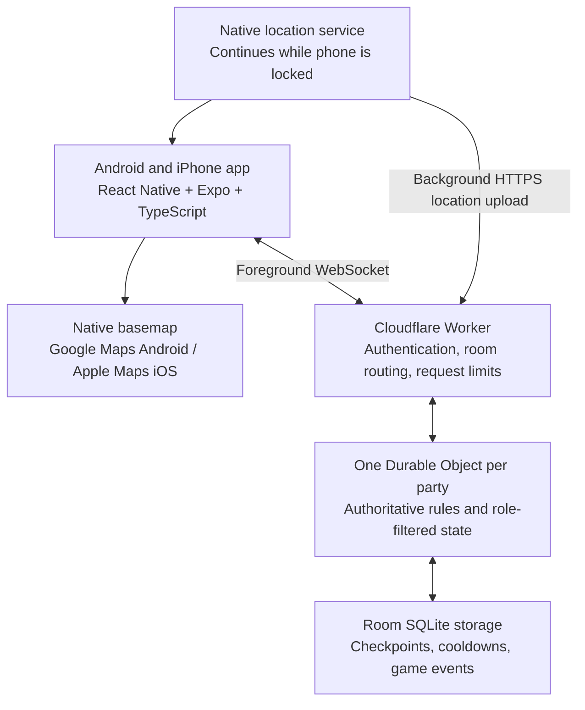

# GPS Hide and Seek: Cross-platform beta architecture

Planning date: September 18, 2026. Prices are USD, before tax, checked against the linked vendor pages. This is a design proposal, not an implemented or deployed app.

## Recommendation

Build an Android and iPhone app with **React Native, Expo development builds, and TypeScript**. Render **Google Maps on Android and Apple Maps on iOS through react-native-maps**. Run an authoritative game room on **Cloudflare Workers + one SQLite-backed Durable Object per party**. Start with anonymous room membership and no separate account service or central database.

This keeps most app and game code shared, provides inexpensive native maps, and puts hidden information and game decisions on a trusted server. Locked-phone tracking is a beta requirement. Validate that on real Android and iPhone hardware before investing in the full UI.

Assumptions: private invite-only parties, initially seven players (one seeker and six hiders), outdoor campus play, cellular/Wi-Fi internet, and configurable rounds. Indoor rooms, building floors, offline multiplayer, voice chat, and public matchmaking are outside this beta. Hiders see themselves and other active hiders; they do not see the seeker by default. That last choice is a proposed interpretation of the game rules and can be changed.

## System layout



Map tiles travel directly from the map provider to the phone. Our server handles small location records and game events. Updating a player marker does not require a map-search, routing, or geocoding API call.

| Layer | Choice | Responsibility |
|---|---|---|
| Mobile app | React Native + Expo + TypeScript | Lobby, map, drawing, role UI, vibration, notifications |
| Native maps | react-native-maps | Basemap, player markers, boundary polygon, permitted circles |
| Location | expo-location + TaskManager initially | Foreground/background fixes, accuracy, timestamps |
| Secure local state | Expo SecureStore | Room credentials and reconnect identity |
| Transport | WebSocket while active; HTTPS from background callbacks | Commands, locations, events, resynchronization |
| API entry | Cloudflare Worker | Authentication, validation, abuse limits, room routing |
| Game server | One Durable Object per party | Hidden state, authoritative rules, ordered mutations |
| Persistence | The object's SQLite storage | Critical actions immediately; compact periodic checkpoint |
| Shared package | Pure TypeScript game rules and schemas | Geometry, protocol validation, deterministic simulations |

Use stable package versions validated together in a short device spike. Keep native location and map code behind small interfaces so either can be replaced without rewriting game rules. The React Native map library supports both native providers. [Expo map documentation](https://docs.expo.dev/versions/latest/sdk/map-view/)

## Maps and their costs

**Recommended: standard native Google Maps on Android, native Apple Maps on iPhone.** Do not configure a Google map ID or cloud map styling for the beta. Google's current SKU rules put native SDK loads without a map ID in the unlimited, no-charge Maps SDK category; map IDs move those loads to Dynamic Maps billing. Android still needs an enabled billing project and an API key restricted to the package and signing certificates. Enable only required APIs. [Google SKU rules](https://developers.google.com/maps/billing-and-pricing/sku-details), [Google pricing](https://developers.google.com/maps/billing-and-pricing/pricing), [Android setup](https://developers.google.com/maps/documentation/android-sdk/start)

Apple's native MapKit is the iOS provider; do not confuse it with separate web-map or server APIs. Native map appearance and campus detail may differ between platforms, while our stored coordinates and geometry stay identical. [Apple MapKit](https://developer.apple.com/maps/), [react-native-maps](https://github.com/react-native-maps/react-native-maps)

| Option | Current published basis | Decision |
|---|---|---|
| Google Android + Apple iOS native maps | Budget $0 for this standard native map configuration | Best beta default; lowest integration and hosting overhead |
| Mapbox native Maps SDK | First 25,000 monthly active users free; next tier $4 per 1,000 MAU | Good alternative when matching custom visual styles matters |
| MapLibre + MapTiler tiles | MapLibre renderer is free; MapTiler Free has 100,000 API requests for personal/testing use; Flex starts at $30/month with 500,000 API requests | Greater provider flexibility, extra tile metering and integration work |
| Self-hosted OpenStreetMap-derived tiles | Data licensing, storage, processing, delivery, and maintenance still apply | Unnecessary operational work for seven-player beta |

Mapbox's React Native integration is community maintained and requires a custom native build. MapLibre is a renderer, not a free hosted map service; third-party rendering against MapTiler generally uses request-based metering. [Mapbox pricing](https://www.mapbox.com/pricing), [Mapbox React Native wrapper](https://github.com/rnmapbox/maps), [MapTiler pricing](https://www.maptiler.com/cloud/pricing/), [MapTiler sessions versus requests](https://docs.maptiler.com/guides/account/sessions-vs-requests/)

Do not rely on the public OpenStreetMap tile servers as an unrestricted production CDN or offline-download service. Follow provider caching and attribution requirements. Store only our own GPS data and user-created game geometry. [OpenStreetMap tile policy](https://operations.osmfoundation.org/policies/tiles/)

Center the map on the host's GPS position and let them pan to the campus. This avoids paying for place search. The beta needs no route planning, street view, address lookup, or satellite-image acquisition service.

## Authoritative game room

Clients request actions; the room server decides outcomes. A phone cannot declare itself untrapped, change its role, reset a cooldown, or eliminate another player. The host manages lobby configuration but receives only the information allowed by their playing role.

Use the lifecycle `LOBBY -> HIDING -> ACTIVE -> FINISHED`, with an explicit `PAUSED` state. Host edits are allowed in the lobby. Starting a round freezes its rule version and boundary. Server timestamps determine the hiding countdown, round deadline, radar window, and cooldowns. The beta defaults are a 10-second hiding period and 30-minute round, with 60-minute rounds used in the cost model.

Start/resume requires each remaining participant to have precise-location access, the chosen background permissions, running tracking, and a recent usable fix. The seeker wins when all hiders are eliminated; surviving hiders win when time expires. A seeker departure pauses the round and requires reconnect or explicit cancellation/restart with a new seeker. Empty parties expire. Transfer lobby administration to a remaining member if the host leaves; this does not grant hidden-map access.

Include a party event feed for joins, start, pause, eliminations, and results. Optional team quick-messages can use the same authorized transport, without a separate chat service. Keep live voice/video out of this beta.

Server messages are built separately for each recipient:

| Recipient | Permitted location data |
|---|---|
| Active hider | Own location and fresh locations of active hider teammates |
| Seeker, normal | Own location only |
| Seeker, radar active | Own location plus fresh active-hider fixes until radar expires |
| Eliminated player | Own device location if desired; no live hidden-player spectator feed |
| Playing host | Exactly the same access as their role |

Never send a complete room object to all phones and hide markers only in the UI. Role filtering must also apply to reconnect snapshots, command replies, event payloads, trap records, debugging logs, and any future admin tools. An untriggered trap and its center are secret from the seeker.

Use a server-issued, signed membership credential bound to room and player, kept in secure device storage. A join code helps find a lobby; it is not sufficient authorization for game actions. Rate-limit code attempts, expire lobbies, let the host approve/lock membership, and require authenticated reconnects. Skip phone-number login and its SMS costs for the beta.

Each command includes a unique ID, protocol version, room/round identity, and expected state version where appropriate. Validate its schema and role, apply it atomically, persist important results, and make retries idempotent. Avoid awaiting external services partway through a game-state mutation.

Cloudflare's Durable Objects provide a per-room coordination point with WebSocket support. Persist essential state because memory is not permanent, including across hibernation. Keep a small bounded outgoing queue and replace obsolete position updates rather than queuing an entire movement history. [Cloudflare WebSocket guidance](https://developers.cloudflare.com/durable-objects/best-practices/websockets/), [Durable Object state](https://developers.cloudflare.com/durable-objects/reference/in-memory-state/)

## Location, locked phones, and network behavior

Foreground: request high-accuracy location, target uploads every 1–2 seconds, and send a consolidated visible-state snapshot up to once per second. Animate permitted markers locally between measured points, but never use animation or extrapolation to award a tag. These are targets, not OS timing guarantees.

Background: start the location service while the app is visible. A globally registered TaskManager callback receives native location updates and performs a short authenticated HTTPS upload to the same room. Its response includes only permitted control state and events. Do not depend on a persistent JavaScript WebSocket, UI components, JavaScript timers, or periodic background jobs while a phone is locked.

The selected Expo path requires configured background permissions and native builds: iOS location background mode and the permissions required by Expo's background API; Android a location foreground service with a persistent notification and required location permissions. Expo Go is insufficient for validating this behavior. Start and stop tracking explicitly with match participation. [Expo Location](https://docs.expo.dev/versions/latest/sdk/location/), [Expo TaskManager](https://docs.expo.dev/versions/latest/sdk/task-manager/)

If Expo callbacks cannot meet the measured reliability requirement, replace the location adapter with a native module using Core Location and Android's fused location provider. Native code still cannot guarantee operation after force-quit, permission revocation, loss of signal, or OS restrictions. [Apple background location](https://developer.apple.com/documentation/corelocation/handling-location-updates-in-the-background), [Android foreground-service restrictions](https://developer.android.com/develop/background-work/services/fgs/restrictions-bg-start)

Every fix carries coordinates, reported horizontal accuracy, optional native speed, sample timestamp, sample age, sequence number, and location-session ID. Record server receipt time too. Estimate a bounded device/server clock offset during connection and use monotonic session timing where available; never compare an uncorrected phone wall clock directly to server time. Reject delayed buffered fixes, stale/replayed fixes, excessive update rates, impossible values, and implausible jumps. Phone-reported coordinates, speed, and ages remain untrusted evidence: this discourages casual cheating but does not prove physical presence.

Starting freshness policy, to tune during field trials:

- Competitive geometry needs recent fixes, initially at most 3 seconds old, with acceptable accuracy for the configured mechanic.
- Fade stale teammate pins and show their age; never represent an old fix as current.
- If the seeker or a remaining active hider stops uploading for 10 seconds, pause the round globally and show a connection problem without revealing hidden coordinates. Exclude eliminated/departed players from liveness checks. The host can remove a departed hider and resume.
- A reconnect receives an authoritative, role-filtered snapshot. Do not replay queued tag or power requests from offline time.
- Persist paused remaining durations so radar/cooldowns/round clocks do not silently expire during a global pause. Restart trap dwell after a pause or unrecoverable observation gap.

The 3-second rule is intentionally demanding for the requested tiny circles. If real locked phones cannot meet it reliably, change the tested game mode or native tracking implementation explicitly. Do not conceal that limitation by using very old coordinates.

## Geometry and game mechanics

### GPS feasibility

The requested tag distance and trap radius are both **20 feet = 6.096 meters**. GPS.gov describes typical smartphone accuracy under open sky around a 4.9-meter radius, with worse performance around obstructions. Both players' errors contribute to a tag, and a trap's placement fix also has error. These dimensions cannot be promised as reliable physical measurements on a campus. [GPS.gov accuracy](https://www.gps.gov/gps-accuracy)

Keep both requested dimensions available as experimental settings. Field-test wider alternatives, such as a 40-foot tag distance and 60-foot trap diameter, before choosing the normal beta preset. These are proposed test values, not proven thresholds. Use reported accuracy to classify outcomes as sufficiently supported, outside, or uncertain; it is an estimate rather than a strict guaranteed error bound. An uncertain observation must not silently eliminate or trap a player.

Compute distances and polygon membership ourselves in meters using suitable geographic math. No paid map API is needed. Do not use native OS geofences for tiny traps: Android recommends much larger regions and documents delayed background transitions. [Android geofencing guidance](https://developer.android.com/develop/sensors-and-location/location/geofencing)

### Boundary

The host draws a closed polygon, with drag-to-edit vertices and undo. Convert screen points to longitude/latitude, simplify freehand input, and validate it on the server: closed ring, no self-intersections, bounded vertex count, and sensible area. Store a versioned GeoJSON polygon. Use a local meter projection for small campus geometry or a tested geographic library; never compare distances directly in latitude/longitude degrees.

All players acknowledge the same boundary before the round. Near its edge, show a warning. Require sustained, sufficiently accurate outside observations before applying a penalty. Proposed beta penalty: an active hider is eliminated after a 15-second confirmed-outside grace period; an outside seeker has tag/radar disabled until returning. Ambiguous fixes pause that grace period. Administrative pause/leave controls always remain available.

A two-dimensional map cannot distinguish floors or reliably decide whether people are separated by a wall. Make the first play area outdoor and ground-level.

### Tag and Hidden Mode

During active play, the server continuously evaluates recent quality-qualified fixes. A moving, non-hidden hider who remains within 6.096 meters of an eligible seeker for one continuously observed second is automatically tagged. A stale, weak, interrupted, trapped, or outside-boundary seeker observation cannot award a tag.

A hider enters private Hidden Mode after four continuously observed stationary seconds, including time during the hiding countdown. Hidden Mode blocks only automatic tags. It ends after credible movement persists for one second: at least three meters beyond the GPS-accuracy allowance or a native speed estimate of at least 0.8 meters per second. Observation gaps, weak GPS, pauses, and resets clear the state. Only the hider receives their status and countdown; never reveal it to the seeker.

The seeker retains the manual **TAG** button for a stationary hider they physically discover. The server checks active round, seeker role, not trapped/outside, input rate, and recent qualified fixes, then chooses the nearest active hider within range regardless of Hidden Mode. Keep the button usable without revealing a target or enabling it conditionally. A failed attempt returns a generic result and a two-second cooldown limits location probing.

For uncertain GPS, refuse both automatic and manual outcomes rather than inventing precision. Automatic and manual success produce the same authoritative tag event, audio, elimination, and win handling, with the tag method retained in diagnostics.

### Radar

On an accepted use, persist `radarEndsAt = serverNow + 3 seconds` and `nextRadarAt = serverNow + 300 seconds`. Proposed rule: radar is ready at the beginning of the active phase. While the window is active, send fresh hider fixes to the seeker; mark unavailable fixes as unavailable without substituting old positions. Stop sending and remove pins at expiry, including after reconnect.

The three-second limit controls future access. A modified client or screenshot can retain information already revealed. This cannot be prevented by hiding a marker afterward.

### Bear traps

On a hider's request, the server validates a recent placement fix, role, charges/cooldown, boundary, and configured limits. It derives the center from the accepted location, not an arbitrary client-supplied map point. Store center accuracy, radius, owner, arming time, expiry, and consumed state.

Initial balance proposal: one charge per hider per round, five-second arming delay, five-minute expiry, single use, no overlapping active traps, and brief immunity after release to avoid repeated trapping. These choices are configurable and need playtesting.

Process seeker fixes against armed trap circles. With short, accurate observation gaps, segment/circle checks can help detect a crossing between samples; never infer a crossing over a large missing interval or noisy fix. Small traps can still be missed or ambiguous when someone runs past.

On a confirmed trigger, consume the trap and persist the seeker's trapped state. Disable game actions on both client and server. Show the triggered circle, return direction if outside it, and dwell progress. Count **15 continuous seconds of sufficiently observed presence**. Confirmed exit resets progress; short ambiguous samples pause credit; a long gap or global pause resets it. Closing/reopening the app does not release the player. Do not award the full 15 seconds just because wall-clock time passed without observations.

The app can enforce game controls, not physical movement or access to the rest of the phone. Leave, pause/help, and system phone functions stay accessible. Provide local notification/vibration when a background upload reports a trap, subject to OS delivery limits.

### Future powers

Implement a small typed power interface: authorization, validation, resource/cooldown cost, authoritative state change, visibility policy, expiry, and emitted events. Begin with radar and trap only. Store a frozen ruleset version per round. Add powers as reviewed server code rather than designing a general scripting system now.

## Storage and privacy

Each room stores a ruleset, polygon, host/member records, roles, round state, active traps, power resources, command deduplication records, and sparse events. Maintain latest fixes in memory and overwrite one compact room checkpoint roughly every five seconds. Persist critical actions immediately and atomically with their resulting state.

This avoids a database write for every individual GPS sample and avoids retaining movement trails. On recovery, restore critical state, mark positions stale until refreshed, and restart uncertain dwell intervals. A host disconnection does not destroy the game; the server owns it.

Stop collecting location on exit, elimination, or round end. Delete live location state promptly at completion and expire abandoned rooms automatically. A proposed cleanup window for residual room data is 24 hours; explicitly opted-in diagnostic traces can use a short separate retention period. Provider backups/recovery retention must be disclosed separately from live-data deletion. Keep identifiers and coordinates out of ordinary logs and crash reports.

A privacy notice must explain active-round background tracking and who receives locations. If the product will serve minors, settle age/consent requirements and provider/store eligibility before broad distribution. Google Maps has an explicit restriction concerning child-directed apps; this needs review if that becomes the target audience. [Google Maps terms](https://cloud.google.com/maps-platform/terms)

## Beta validation and rollout

1. **Location feasibility first.** Build a minimal signed Android app and iPhone build. Walk the actual campus with locked phones, both moving and stationary. Measure fix age, GPS drift, missed crossings, battery drain, and network gaps for 30–60 minutes. Include a Pixel, a Samsung, and an iPhone where available. This is the gate for the requested radii and background support.
2. **Playable room.** Implement anonymous join, roles, draw/edit boundary, countdown, foreground/background transport, reconnect, and server-filtered pins. Test with seven physical phones.
3. **Authoritative mechanics.** Add tagging, radar, traps, pause, boundary penalties, and round results. Use deterministic simulated routes and a server-controlled clock to verify cooldowns, duplicate commands, simultaneous events, stale fixes, and trap dwell resets.
4. **Fairness and privacy tests.** Inspect seeker network payloads before/during/after radar; test host-as-seeker and reconnect. Verify no concealed coordinates leak. Force-close, revoke permissions, disable data, and restart the server during a trap. Verify recovery and pause behavior.
5. **Invite beta.** Distribute Android builds and iOS TestFlight builds. Record match completion rates, false/missed tags/traps, background upload gaps, and battery use. Tune rules from those results before adding more powers.

Suggested release goals, to validate rather than assume: 95% of moving-player fixes arrive within three seconds under normal campus coverage; accepted actions normally acknowledge within one second; a round completes on locked phones without unexplained tracking loss. If these fail, the beta is not ready for the requested tiny-radius automatic mode.

Suggested repository layout:

```text
apps/mobile/             React Native app and platform adapters
services/game-server/    Worker routes and Durable Object room
packages/game-core/      Pure rules, geometry, power definitions
packages/protocol/       Message schemas and shared types
tests/simulation/        Recorded/synthetic route and clock scenarios
docs/                    Rules decisions, field tests, privacy notes
```

## Operating-cost model

### Assumptions and calculation

One room, seven players participating for the entire one-hour round, one location upload per phone every two seconds, and up to one visible-state snapshot per phone per second. Eliminated players stopping tracking normally reduce actual usage:

```text
Inbound locations:  7 x 3,600 / 2 = 12,600 per round
Outbound snapshots: 7 x 3,600     = 25,200 per round
Room checkpoints:   3,600 / 5     =    720 per round
Active room usage:  3,600 x 0.128 =  460.8 GB-seconds per round
```

Snapshots are batched lists of authorized players, not separate broadcasts for every pin. A one-kilobyte snapshot yields roughly 25.2 MB of outbound payload across the whole party per hour. At an illustrative 200 bytes per fix, uploads add 2.52 MB. These are payload estimates, excluding map tiles, HTTPS/TLS/protocol overhead, reconnects, app downloads, and diagnostics. Measure actual mobile-data use.

Budget active rounds as fully awake: a one-second timer prevents hibernation. Use the hibernation API and clear timers for idle lobbies and completed rounds; do not assume active gameplay has zero duration cost. Five-second checkpoints keep 10,000 rounds at approximately 7.2 million checkpoint writes before game events. Saving every player's every fix separately would instead create 126 million writes.

Workers Paid starts at $5/month. Its request/CPU allowances cover the small beta. Durable Objects includes 1 million requests and 400,000 GB-seconds monthly; excess rates are $0.15/million requests and $12.50/million GB-seconds, rounded up by billing unit. Inbound WebSocket messages receive a 20:1 request discount; outgoing messages have no request charge. SQLite includes 50 million written rows/month. [Durable Objects pricing](https://developers.cloudflare.com/durable-objects/platform/pricing/)

HTTPS background uploads are ordinary requests through both the Worker and room. Worker allowance: 10 million requests and 30 million CPU-milliseconds monthly, with excess $0.30/million requests and $0.02/million CPU-milliseconds. There is no separate Worker egress charge. [Workers pricing](https://developers.cloudflare.com/workers/platform/pricing/)

| Seven-player, one-hour rounds/month | All uploads via WebSocket: modeled backend | All uploads via HTTPS: modeled backend | Rounded planning budget |
|---:|---:|---:|---:|
| 100 | $5.00 | $5.15 | **$6/month** |
| 1,000 | $17.50 | $20.08–$20.74 | **$25/month** |
| 10,000 | $68.40 | $123.14–$133.23 | **$140/month** |

The HTTP range assumes 1–5 ms of Worker CPU per upload. It is a transport sensitivity estimate, not a measured performance result or a guarantee. Actual locked-phone usage mixes foreground sockets and background uploads; the upper column budgets every upload over HTTP. Included storage and sampled logs are assumed sufficient. Add usage for lobbies, action messages, reconnects, retries, pauses, and sustained faster upload rates. Account allowances are shared with other deployments. A long-paused room should stop its high-frequency timer and use durable deadlines/alarms.

For reproducibility, monthly DO duration is `rounds * 460.8`. Charge `ceil(max(0, duration - 400,000) / 1,000,000) * $12.50`. Modeled DO requests per round are 637 with WebSockets or 12,607 with HTTPS (seven initial connections plus location traffic). Apply the published allowances and rounding. This explains why charges rise in steps instead of scaling perfectly smoothly.

Cloudflare's free plan may cover a handful of friends' games, but daily limits can stop service. The paid plan is a sensible beta default. Configure upload/message limits, bounded rooms/traps/duration, sampled telemetry, and active-room admission limits. Billing alerts inform us; they are not hard spending caps. Never log every coordinate update by default.

### Why not start with Supabase or Firebase?

| Backend | Strength | Cost/implementation consequence for this game |
|---|---|---|
| Cloudflare Workers + Durable Objects | One authority per room, inexpensive fan-out | Recommended; room/auth/admin code is ours, and platform APIs create some vendor coupling |
| Supabase | Convenient Postgres, accounts, dashboards | Realtime charges for delivery fan-out; an authoritative rule processor is still needed |
| Firebase Realtime Database | Mature mobile integration, bandwidth-oriented billing | Viable runner-up; separate secret input/output paths and coordinate authoritative processing |
| Firestore | Durable application records | Avoid for frequent GPS listeners; changes generate repeated document-read charges |

Supabase Free includes 2 million realtime messages; Pro starts at $25/month with 5 million, then $2.50 per started million. Broadcast counts sending plus every recipient. One hider snapshot to six clients and one seeker snapshot to one client each second is `(1+6+1+1)*3,600 = 32,400` metered messages per round. At 100/1,000/10,000 rounds this is approximately **$25/$95/$822.50 for Pro plus outgoing Broadcast alone**. Location ingestion, authoritative compute, excess bandwidth, and peak connections add cost. [Supabase message billing](https://supabase.com/docs/guides/platform/manage-your-usage/realtime-messages), [Supabase plans](https://supabase.com/pricing), [Connection billing](https://supabase.com/docs/guides/platform/manage-your-usage/realtime-peak-connections)

Firebase RTDB bills downloaded data and storage. At one-kilobyte snapshots, 100/1,000/10,000 rounds produce 2.52/25.2/252 GB of snapshot payload. Its published paid download rate is $1/GB beyond the allowance, so delivery alone is roughly **$0/$15/$242**, depending on daily activity distribution. That excludes protocol overhead, input processing, server-side downloads, and authoritative game-server compute. The current pricing page expresses the paid-plan no-cost download allowance daily; its billing guide still describes a monthly allowance, so confirm billing setup before choosing it. [Firebase pricing](https://firebase.google.com/pricing), [RTDB billing](https://firebase.google.com/docs/database/usage/billing)

These competitor estimates are deliberately partial and are not equivalent full-stack quotes. The architectural advantage of one room authority matters as much as the price. In particular, Firestore listeners bill reads for changed documents, making it a poor default for high-frequency location fan-out. [Firestore billing](https://firebase.google.com/docs/firestore/pricing)

Add a central database such as D1 only when we need persistent profiles, saved campuses, or cross-match history. Keep the live rules in pure TypeScript functions and infrastructure adapters separate so migration remains possible.

## Distribution and other costs

| Item | Beta budget / implication |
|---|---|
| Maps | $0 under the recommended native configuration and current pricing |
| Backend | Start around $6/month at 100 modeled rounds; free tier can suffice for smaller experiments |
| Apple Developer Program | $99/year for the planned iOS distribution path |
| Google Play Console | $25 one-time registration |
| Expo EAS cloud builds | Free tier currently includes 15 Android and 15 iOS builds/month; low-priority queue |
| Optional EAS Starter | $19/month plus usage, with $45 build credit |
| Accounts and SMS | $0 separate service in this design; private guest membership only |
| Push/local alerts | Local notifications first; no paid messaging vendor needed |
| Monitoring | Start with included, sampled server logs and a free crash-reporting allowance if needed |
| Website/domain | Default hosted address initially; a custom domain is optional and separately priced |
| Test hardware and development | Existing Android plus access to real iPhones; engineering and outdoor testing are the main non-hosting costs |
| Player costs | Mobile-data use and battery drain; measure both during the field trial |

Sources: [Apple enrollment](https://developer.apple.com/programs/enroll/), [Play registration](https://support.google.com/googleplay/android-developer/answer/6112435?hl=en), [Expo pricing](https://expo.dev/pricing).

Android can start with a signed installable build or Play internal testing. Internal testing supports up to 100 testers. Public production access for a new personal Play account has a separate requirement of at least 12 opted-in closed testers over 14 continuous days; the seven-person party alone does not satisfy that later gate. [Play test tracks](https://support.google.com/googleplay/android-developer/answer/9845334?hl=en-GB), [Production testing requirements](https://support.google.com/googleplay/android-developer/answer/14151465?hl=en)

Use TestFlight for iPhone testers; external distribution includes beta review, and builds expire after 90 days. EAS can build iOS from a Windows development machine, but cannot substitute for testing on an actual iPhone. [TestFlight](https://developer.apple.com/testflight/), [Build expiration](https://testflight.apple.com/), [Expo FAQ](https://docs.expo.dev/faq/)

Avoid buying paid map, analytics, SMS, voice, or database subscriptions before field testing proves the basic game. For the 100-round example, a first-year infrastructure/distribution allowance is approximately **$196**: $6 x 12 + $99 Apple + $25 Play. This excludes engineering, hardware, tax, domain purchase, paid build overages, and optional services; it is a planning estimate, not a fixed-price commitment.

## Decisions to carry into implementation

Committed requirements: shared Android/iPhone codebase; locked-phone play; server-hidden hider locations and Hidden Mode state; host-drawn boundary; automatic moving-player tags plus manual physical-discovery tags; three-second radar with five-minute cooldown; 20-foot-radius trap with 15-second dwell lock.

Proposed defaults to validate: outdoor play, hiders do not see seeker, initial radar availability, hiding/round duration, trap charges/expiry, boundary penalties, uncertain-GPS fallback, and disconnection pause behavior. The requested distances remain an experimental preset until real-device evidence supports them. No additional product decision blocks starting the location feasibility milestone.
