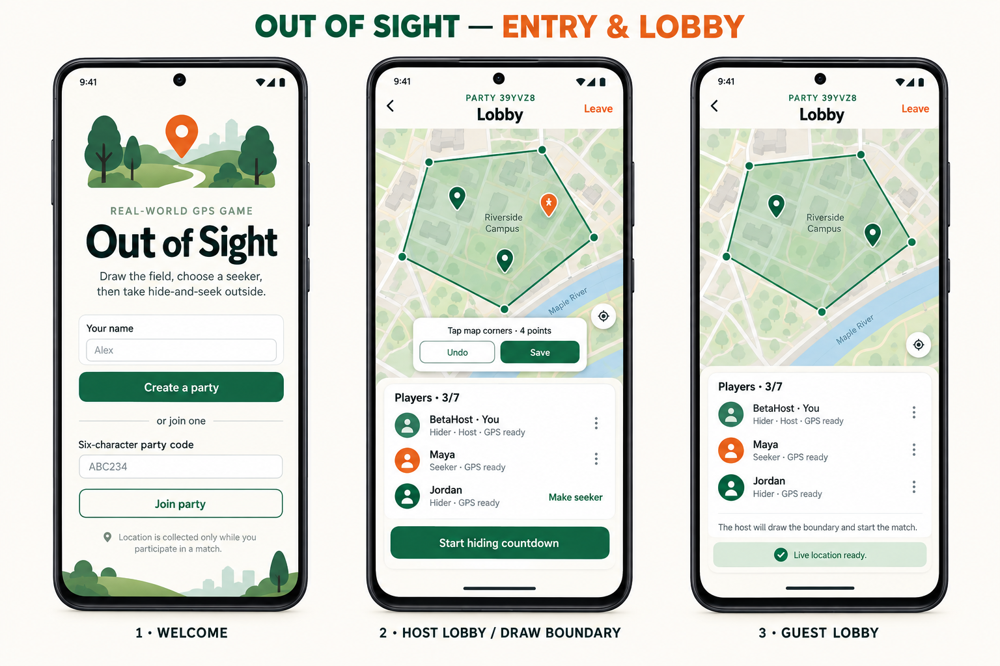
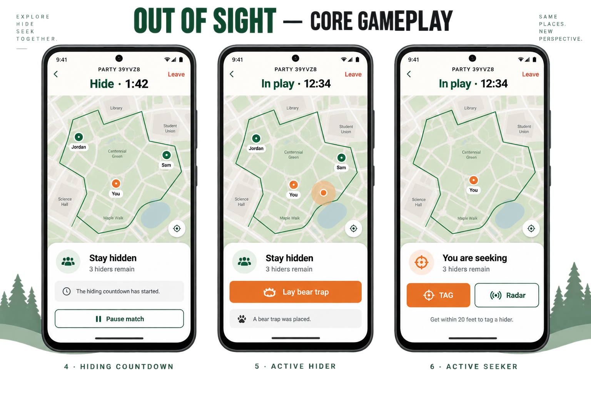
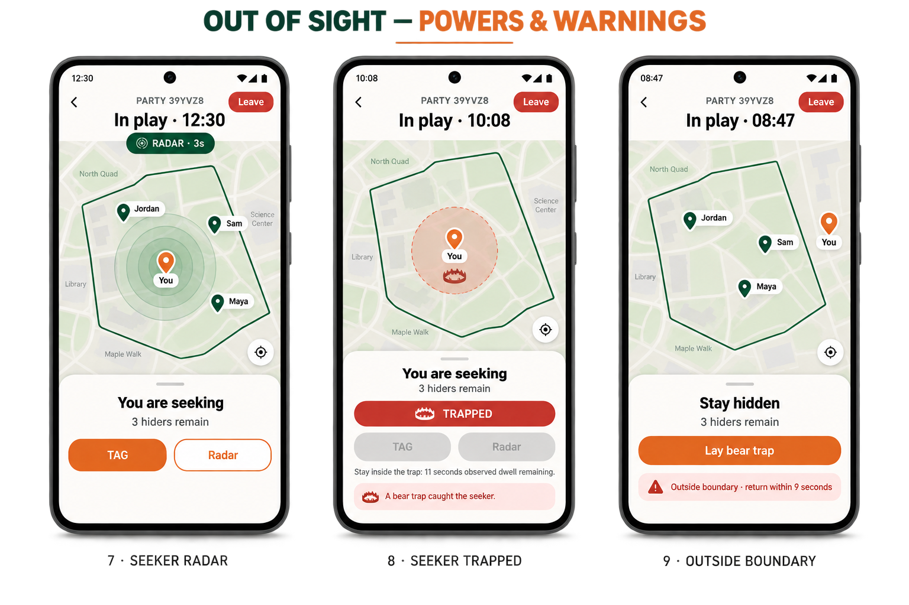
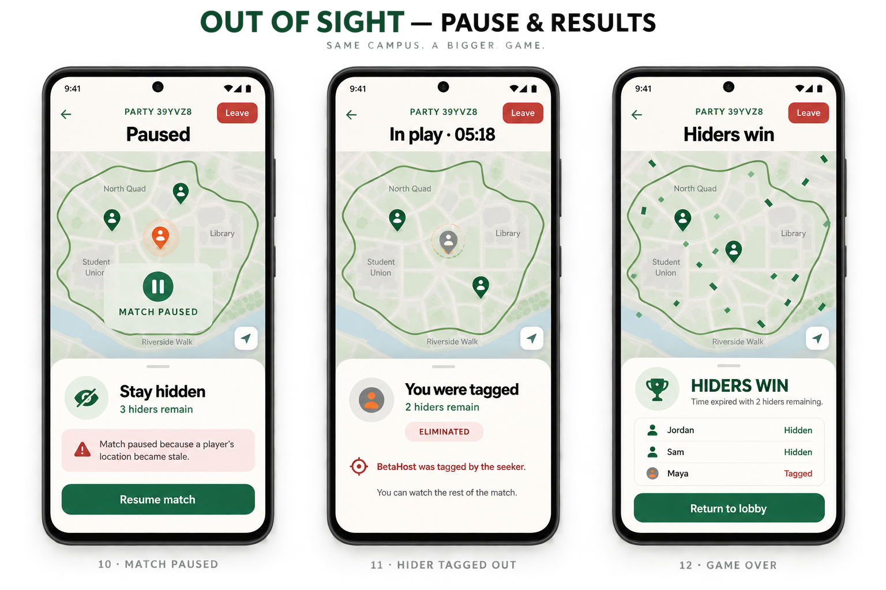

# Out of Sight UI screens

These concept boards cover the major player-facing states for the beta. They use the implemented role-visibility rules: hiders can see active hiders but never the seeker; the seeker sees only their own position except during the three-second radar reveal.

## Entry and lobby

1. Welcome and create/join party
2. Host lobby and boundary drawing
3. Guest lobby

## Core gameplay

4. Hiding countdown
5. Active hider
6. Active seeker

## Powers and warnings

7. Seeker radar reveal
8. Seeker trapped by a bear trap
9. Outside-boundary warning

## Pause and results

10. Match paused
11. Hider tagged out
12. Game over

The result card and return-to-lobby treatment on screens 11 and 12 are proposed presentation improvements. The current beta represents these states more minimally through the shared game panel and event feed.
